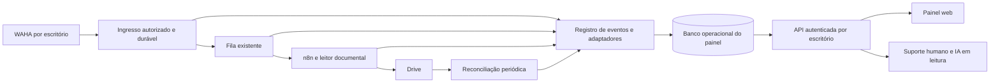

# Painel de Operações Documentais — PRD e plano de arquitetura

Data: 2026-10-11. Estado: planejamento; não implementado nem publicado.

## 1. Resultado e diagnóstico
Francisco e cada contabilidade devem descobrir, sem consultar uma IA, o que chegou, onde está, por que parou e quem precisa agir. A IA de suporte consulta a mesma API e evidências do painel.

[KNOWN — inspeção local] A fila PLX possui jobs com status, tentativas, erro, resposta e datas; oferece health, consulta individual e retry de falha terminal. Isso não equivale a uma trilha imutável de todas as transições nem a uma API de listagem multiempresa. Fontes: `plx-ingress-queue/queue_service.py` e README correspondente.

[KNOWN — documentação local] O pacote `outputs/operacoes-conversacionais-v1` já descreve bindings, contratos multiempresa, outbox e checklist em homologação. Reutilizar contratos e componentes após verificar compatibilidade; não presumir implantação pelo README.

[NOT VERIFIED nesta tarefa] Estado atual do VPS, cobertura dos registros históricos, retenção efetiva e correspondência de todos os arquivos do Drive. Este plano não certifica o fluxo PLX.

Decisões do usuário: infraestrutura n8n/WAHA/armazenamento administrada pelo fornecedor; WhatsApp pertence à contabilidade; isolamento por escritório e grupo; relatórios por categorias e observações, sem valores ou lucro.

## 2. Telas prioritárias
| Tela | Pergunta respondida | Conteúdo |
|---|---|---|
| Visão geral | Há algo parado agora? | recebimentos observados, fila, processamento, armazenados, revisões, falhas e confirmações pendentes; última coleta |
| Grupos | Qual grupo está funcionando? | escritório, empresa vinculada, sessão, último evento, última mídia, última organização, verificação de captura, destino Drive |
| Documentos | O que aconteceu com este arquivo? | busca por nome/ID, filtros de período/grupo/tipo/setor, situação de processamento, revisão e notificação |
| Ficha do documento | Qual a evidência? | linha do tempo, original e destino, emissor/destinatário, empresa arquivista, regra aplicada, tentativas, modelo, erro compreensível e IDs técnicos expansíveis |
| Pendências | O que precisa de ação humana? | motivo, responsável, prazo interno, evidência, ação permitida e resultado |
| Histórico e relatórios | O que mudou e o que foi entregue? | eventos auditáveis, relatório diário, exportação CSV e divergências |

Visão do fornecedor reúne escritórios autorizados; visão da contabilidade limita-se aos próprios grupos. Folha/atestados exigem permissão de departamento também no acesso ao Drive; esconder na interface não basta.

## 3. Semântica dos estados
Manter dimensões independentes:
- Processamento: RECEBIDO, NA_FILA, PROCESSANDO, ARMAZENADO, DUPLICADO, FALHOU.
- Revisão: NAO_NECESSARIA, PENDENTE, RESOLVIDA.
- Confirmação: NAO_SOLICITADA, PENDENTE, ACEITA_PELO_CANAL, ENTREGUE, FALHOU, DESCONHECIDA.
- Integridade: NAO_VERIFICADA, VERIFICADA, DIVERGENTE, VERIFICACAO_INDISPONIVEL.

Exemplo: ARMAZENADO + PENDENTE + FALHOU significa documento salvo, requer conferência e aviso não enviado. Não repetir OCR/Drive para corrigir apenas o aviso. Resposta HTTP do WAHA não prova leitura ou entrega; só marcar ENTREGUE com evidência de recibo compatível.

RECEBIDO significa evento persistido pela aplicação, não todos os arquivos que existem no WhatsApp. Sessão WORKING e fila vazia não demonstram captura completa. Ausência de eventos em grupo silencioso não é falha por si só.

## 4. Arquitetura proposta

Primeira entrega: painel de leitura com adaptadores das fontes existentes; processamento continua no fluxo atual. Não migrar a fila para construir o painel. Banco próprio e credencial própria para dados do painel; avaliar reaproveitar o servidor PostgreSQL existente após medir recursos. Nunca depender de escrita direta nas tabelas internas do n8n.

Coletor com cursor, sobreposição e deduplicação para recuperar eventos após indisponibilidade. Escrita de eventos críticos deve ser durável no ponto de origem, com outbox local/transacional onde possível; coletor reconciliador cobre intervalos. Falha do painel não perde documentos nem aciona reprocessamento cego.

Atualização proposta: polling de 15 segundos no painel, com última coleta e indicação de dados atrasados após 60 segundos (limiares configuráveis, a validar). Registrar horário UTC; apresentar fuso do escritório. Reconciliação Drive por lote e cadência configurada, não a cada acesso à tela.

## 5. Modelo de dados mínimo
- offices, users, memberships: identidade e permissões, por escritório.
- group_bindings: office_id, session_id, group_id, company_id, drive_root_id, policy_version, enabled.
- documents: office_id, binding_id, message_id, received_at, source_hash, source_file_id, canonical_document_id, estados independentes, classificação e evidências.
- processing_attempts: documento, job_id, execution_id, workflow_version, início/fim, rota/modelo, resultado e erro sanitizado.
- document_events: event_id, office_id, document_id, tipo, occurred_at, observed_at, origem, ator e referência de evidência; append-only para a aplicação.
- notifications: documento/relatório, idempotency_key, status, canal, provider_message_id e tentativas.
- incidents, reviews, integration_checks, daily_reports: responsáveis, histórico de decisão, saúde, cobertura e snapshots.

Chaves de deduplicação incluem escritório e binding conforme política. Nunca compartilhar resultados por hash entre escritórios. FKs compostas impedem associação cruzada; índices por escritório/data, grupo/status e documento/horário. Um arquivo pode conter vários documentos: recebimentos, arquivos únicos e documentos lógicos têm contagens diferentes.

Importação histórica somente por evidência existente. Não inventar duração de etapas ou notificações passadas: registrar origem e cobertura parcial. Alterações de política não reescrevem o histórico.

## 6. API e controle de acesso
API do painel autentica usuários individualmente e resolve office_id pela autorização do servidor. Sem chaves WAHA/n8n/Drive no navegador. Perfis: administrador da operação, gestor do escritório, operador por departamento e leitor. IA usa identidade de serviço com escopo de leitura e auditoria; alterações futuras passam pelos mesmos comandos autorizados.

Rotas propostas:
- GET /v1/overview?from=&to=: contadores, unidade, fuso, observed_at, coverage e stale.
- GET /v1/groups: bindings visíveis, saúde e horários.
- GET /v1/documents?group_id=&status=&cursor=: lista paginada e filtrada.
- GET /v1/documents/{id}: ficha, estados e evidências.
- GET /v1/documents/{id}/events: linha do tempo paginada.
- GET /v1/incidents e /v1/reports: pendências e fechamento.
- POST /v1/documents/{id}/retry: etapa permitida, motivo e Idempotency-Key; fase 2.
- POST /v1/reviews/{id}/resolve: versão esperada, decisão e justificativa; fase 2.

Exemplo resumido: {"document_id":"doc_exemplo","processing":"ARMAZENADO","review":"PENDENTE","notification":"FALHOU","integrity":"VERIFICADA","observed_at":"2026-10-11T17:00:00Z"}.

Sem acesso: 401; fora do escopo: 404; conflito de versão/estado: 409; payload inválido: 422. Retry não pode repetir sucesso, concorrer com processamento vigente ou deslocar arquivo silenciosamente. Comandos registram solicitante, motivo, antes/depois e resultado. Links Drive obedecem permissões reais; sem links públicos.

## 7. Auditoria e alertas
Registrar também ingresso recusado com motivo, sem armazenar conversas privadas ou conteúdo não autorizado. Para rejeição sem vínculo, somente metadados mínimos de segurança, sem exposição ao cliente.

Alertas: sessão desconectada; credencial expirada; erro de webhook; runner indisponível; fila sem progresso; documento sem destino verificável; confirmação falha; coleta atrasada. Resolver alerta com evidência e guardar histórico. Definir tempo excessivo por etapa após medir p50/p95, diferenciando PDF nativo, OCR e reforço IA.

Captura: comparar, quando o provedor permitir, mídias do grupo autorizado com ocorrências persistidas usando cursor. Exibir cobertura desconhecida quando não houver acesso ao histórico. Reconciliação de documento: ingresso → job → execução → manifesto → arquivo Drive → confirmação. Drive indisponível não significa arquivo excluído.

Segredos, cabeçalhos, corpo integral de documento e dados clínicos não entram em logs gerais. Proposta de retenção: logs técnicos sanitizados 30 dias, eventos operacionais 12 meses, configuráveis por contrato; documentos seguem política própria. Backup com teste de restauração inclui banco de auditoria e bindings.

## 8. Ordem de implementação e entregáveis
1. Inventário vivo: confirmar fontes, schema, endpoints, permissões e amostra de documentos PLX. Entrega: mapa de campos e cobertura histórica.
2. Instrumentação: IDs correlacionáveis, transições, outbox de eventos e adaptadores. Entrega: API de leitura alimentada com dados reais; falha de coletor testada.
3. Painel interno: visão geral, grupos, lista, ficha e pendências; autenticação desde o início. Entrega: Francisco encontra um arquivo e identifica o gargalo sem assistência.
4. Portal da contabilidade: escopo por escritório/departamento, permissões Drive e relatórios. Entrega: isolamento comprovado com duas contas de teste.
5. Ações auditadas: retry somente da etapa falha e resolução de revisão; onboarding automatizado depois desses gates.

MVP inclui etapas 1–3; acesso comercial inclui etapa 4. Checklist e lembretes aparecem posteriormente usando contratos OC existentes, sem ativar os candidatos de homologação por efeito deste plano. Sem construtor visual de workflows, cobrança ou chat genérico no MVP.

## 9. Aceitação obrigatória
- Arquivo novo rastreável até Drive e confirmação com IDs correlacionados.
- PDF ilegível arquivado com revisão; sem falsa indicação de conclusão integral.
- Documento alheio à empresa segue política autorizada e revela o motivo, sem destino incorreto.
- Reenvio gera ocorrência própria e aponta ao arquivo canônico sem nova cópia final.
- Armazenamento com aviso falho permanece salvo; retry do aviso não duplica o arquivo.
- Falha anterior à fila fica visível; nenhuma evidência disponível resulta em estado desconhecido, não sucesso.
- Reinício de coletor recupera eventos sem duplicar; painel indisponível não perde trabalho.
- Duas contas de escritórios distintos não acessam dados, buscas, exports, eventos ou arquivos uma da outra.
- Dados sem atualização mostram atraso; botão Atualizar faz nova consulta e informa erro.
- Relatório diário reconcilia categorias, pendências e backlog, com data de recebimento distinta da data documental.
- Retentativa concorrente é rejeitada e auditada; backup restaura configurações e histórico em ensaio.

## 10. Próxima execução
Implementar primeiro o inventário e contrato de leitura PLX, seguido do painel interno. O plano prioriza visibilidade antes de ampliar clientes ou microfluxos. Publicação será descrita separadamente de planejamento, implementação e homologação.
