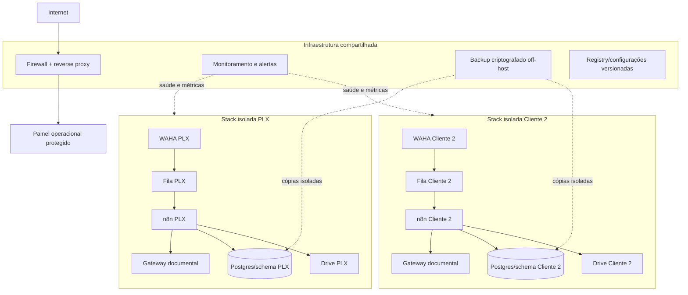
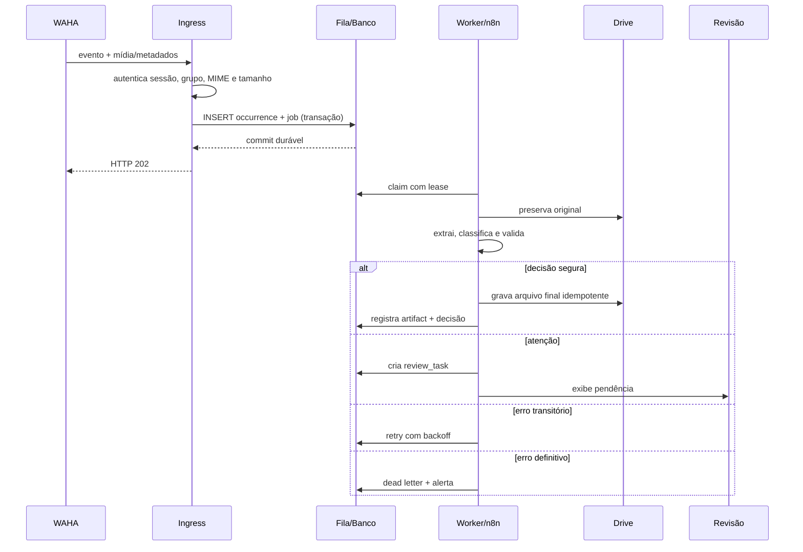

# Arquitetura VPS multi-cliente e plano seguro de migração

**Data:** 2026-10-04
**Origem:** laboratório Docker local PLX
**Objetivo:** colocar a triagem documental em produção sem permitir que falha, erro de configuração ou dado de um cliente prejudique outro.

## 0. Decisão executiva

Não existe operação com “risco zero”. A garantia comercial correta é construída com quatro propriedades verificáveis:

1. **evitar:** controles impedem erros conhecidos;
2. **conter:** uma falha fica limitada ao cliente afetado;
3. **detectar:** monitoramento informa a falha antes que ela fique invisível;
4. **recuperar:** filas, backups e runbooks restauram a operação sem perder documentos.

Para os primeiros clientes, a arquitetura recomendada é:

> **uma stack de processamento isolada por cliente, com infraestrutura comum somente para proxy, observabilidade e backups.**

Não usar um único workflow, uma única tabela ou as mesmas credenciais para todos. O núcleo de código pode ser o mesmo; o estado operacional precisa ser isolado.

## 1. Por que simplesmente copiar o Docker local para o VPS é insuficiente

O laboratório atual foi criado para validar a PLX. Ele ainda contém características inadequadas para produção multi-cliente:

- dados reais e benchmarks chegaram a compartilhar o mesmo manifesto;
- parte da identidade da empresa está fixa no workflow;
- o recebimento pode ser confirmado antes da persistência durável;
- fila SQLite e manifesto não possuem uma transação comum;
- não existe prova de backup e restauração da stack atual;
- WAHA e gateway ainda têm lacunas de reinício e observabilidade;
- NVIDIA gratuita não é base licenciada para produção;
- não há painel único de pendências humanas;
- o fechamento não reconcilia toda a jornada do documento.

Migrar esse estado agora apenas mudaria o local do risco.

## 2. Arquitetura recomendada para os primeiros clientes



### Compartilhável no VPS

- Caddy, Traefik ou Nginx;
- firewall;
- Prometheus/Grafana ou monitor equivalente;
- Loki ou logs centralizados;
- serviço de alerta;
- mecanismo de backup;
- registry de imagens;
- código e templates versionados.

### Isolado por cliente

- projeto/rede Docker;
- sessão e volume WAHA;
- fila de recebimento;
- banco/schema e manifesto;
- credenciais n8n;
- chave interna de webhook;
- pasta raiz do Drive;
- catálogo de empresas/CNPJs;
- políticas e limiares;
- logs com `tenant_id`;
- backup e restauração;
- limites de CPU, memória, tamanho e volume.

### Gateway de IA

No primeiro momento, pode existir um gateway por cliente para reduzir o raio de impacto. Depois da homologação de dois ou três clientes, pode virar serviço compartilhado desde que:

- exija autenticação por cliente;
- imponha cotas;
- registre consumo sem guardar o documento integral;
- não permita que o cliente escolha qualquer modelo;
- possua timeouts e circuit breaker;
- nunca misture cache ou conteúdo entre clientes.

## 3. Banco e estado operacional

SQLite continua aceitável para uma fila pequena e isolada, mas não deve ser o centro da operação multi-cliente. A recomendação para produção é Postgres.

### Entidades mínimas

```text
tenants
tenant_integrations
authorized_sources
companies
document_occurrences
document_contents
processing_jobs
processing_attempts
document_decisions
review_tasks
delivery_artifacts
daily_reconciliations
audit_events
```

### Separação de conceitos

- `document_occurrences`: cada mensagem recebida;
- `document_contents`: cada conteúdo único por SHA-256 e escopo;
- `processing_jobs`: trabalho assíncrono;
- `delivery_artifacts`: arquivo no Drive e seu estado;
- `review_tasks`: decisão humana pendente;
- `audit_events`: trilha imutável.

### Invariantes obrigatórios

1. toda linha possui `tenant_id` imutável;
2. SHA nunca é pesquisado sem `tenant_id` e escopo da empresa;
3. `message_id` é único dentro do canal/sessão do cliente;
4. arquivo final só é considerado entregue quando manifesto e armazenamento estão reconciliados;
5. um documento nunca muda de cliente;
6. nenhuma consulta operacional aceita `tenant_id` vindo livremente do documento;
7. credencial do cliente não acessa a raiz de outro cliente;
8. erro ou baixa confiança gera estado explícito, não desaparecimento.

## 4. Pipeline confiável de recebimento



O ACK ocorre depois do commit. A mídia pode ser salva no ingress antes do ACK quando o link do WAHA não oferece durabilidade suficiente.

## 5. Tratamento de falhas

| Falha | Comportamento obrigatório | Nunca fazer |
|---|---|---|
| WAHA desconectado | alerta, tentativa controlada, cursor/backfill | fingir que o grupo continua monitorado |
| n8n indisponível | fila acumula com limite e alerta | perder evento após ACK |
| NVIDIA indisponível | retry/circuit breaker ou revisão | marcar como organizado |
| Drive indisponível | manter job pendente e original preservado | confirmar entrega |
| documento ilegível | fila de atenção | inventar campos |
| PDF truncado/múltiplo | atenção explícita | analisar somente parte silenciosamente |
| timeout | lease impede execução paralela | iniciar retry concorrente |
| canônico apagado | promover nova cópia ou revisão | confirmar duplicata inexistente |
| banco indisponível | não retornar ACK positivo | processar sem trilha |
| disco quase cheio | pausar ingresso controladamente e alertar | continuar até corrupção |
| backup falhou | alerta crítico e correção imediata | assumir que volume é backup |

## 6. Observabilidade e SLOs

### Métricas técnicas

- `documents_received_total{tenant}`;
- `documents_completed_total{tenant,status}`;
- `documents_backlog{tenant,state}`;
- `document_processing_seconds{tenant,type}`;
- `job_attempts_total{tenant,result}`;
- `dead_letter_jobs{tenant}`;
- `review_tasks_open{tenant,reason}`;
- `waha_session_up{tenant}`;
- `drive_operation_errors_total{tenant}`;
- `ai_requests_total{tenant,provider,result}`;
- `ai_cost_estimated{tenant}`;
- `backup_last_success_timestamp{tenant}`;
- `reconciliation_mismatches{tenant}`;
- uso de disco, memória, CPU e banco.

### SLOs iniciais para o piloto

Os números abaixo são metas propostas e precisam ser ajustados após medir a PLX:

| SLO | Meta inicial |
|---|---:|
| Ocorrências aceitas com registro durável | 100% |
| Documentos perdidos | 0 |
| Falso “organizado” conhecido | 0 |
| Backlog sem visibilidade | 0 |
| Disponibilidade mensal do processamento | 99,0% no piloto |
| Detecção de componente indisponível | até 5 minutos |
| RPO de banco/fila | até 15 minutos |
| RTO de serviço | até 4 horas no piloto |
| Revisão de pendência | definido por contrato com o cliente |

### Alertas acionáveis

- WAHA desconectado por mais de 2 minutos;
- fila sem consumo por 5 minutos;
- job em processamento além do lease;
- primeira falha definitiva;
- backlog acima do limite do cliente;
- Drive ou IA com taxa de erro elevada;
- disco acima de 75% e 85%;
- backup sem sucesso dentro da janela;
- divergência na reconciliação diária;
- certificado perto do vencimento.

Cada alerta precisa apontar para um runbook e um responsável.

## 7. Backup e recuperação

### Regra 3-2-1 adaptada

- dados de produção no VPS;
- backup criptografado em armazenamento externo;
- uma cópia adicional com retenção/imutabilidade;
- credenciais guardadas fora do backup comum;
- restauração testada, não apenas upload confirmado.

### O que copiar

- banco Postgres e migrações;
- configuração versionada sem segredos;
- credenciais n8n criptografadas e a chave de criptografia separadamente;
- sessões WAHA conforme política e viabilidade;
- fila e dead letters;
- manifestos e auditoria;
- mapeamento dos IDs/pastas do Drive;
- dashboards, alertas e runbooks.

### Ensaio obrigatório

Mensalmente, restaurar um cliente em rede isolada e comprovar:

1. banco íntegro;
2. workflows na versão esperada;
3. jobs pendentes recuperados sem duplicação;
4. credenciais acessíveis somente no ambiente autorizado;
5. reconciliação com os artifacts esperados;
6. tempo real de recuperação registrado.

## 8. Segurança do VPS

- somente 80/443 públicos pelo proxy;
- SSH por chave, sem login root por senha;
- firewall com política deny-by-default;
- WAHA, n8n, banco e gateway sem portas públicas;
- painel n8n protegido por autenticação forte e, preferencialmente, VPN/allowlist;
- API keys com escopo e rotação;
- secrets fora do Git e do Compose;
- imagens fixadas por digest e atualização controlada;
- containers sem privilégio e com filesystem somente leitura quando possível;
- limites de recursos por cliente;
- logs sem documento integral, token ou dado pessoal desnecessário;
- atualização de segurança com janela e rollback;
- varredura de vulnerabilidades das imagens;
- inventário de subprocessadores e fluxos de dados.

## 9. Dimensionamento inicial

Não há dados reais suficientes para dimensionar com precisão. Para os primeiros clientes, começar com capacidade conservadora e medir.

### Perfil inicial sugerido para homologação

- 4 vCPU;
- 8 GB RAM;
- 100 GB SSD;
- backup externo;
- swap limitada apenas como proteção, não como capacidade normal;
- monitoramento de recursos por container.

Esse perfil é uma hipótese. OCR de PDFs escaneados e múltiplas sessões WAHA são os maiores consumidores. O segundo cliente só entra depois de medir CPU, RAM, disco e latência p95 da PLX.

### Gatilhos de expansão

- CPU acima de 70% sustentada;
- memória acima de 80%;
- disco acima de 70%;
- p95 de processamento além do contratado;
- backlog recorrente;
- duas ou mais sessões WAHA instáveis;
- OCR concorrente causando timeout.

## 10. Sequência de migração

### Etapa 0 — corrigir localmente

- isolar produção e benchmark;
- corrigir ACK durável;
- alinhar timeout/lease;
- blindar dedupe e exclusão;
- corrigir fechamento e pendências;
- homologar versão atual com amostra real.

**Gate:** nenhum bloqueador crítico aberto.

### Etapa 1 — construir VPS de homologação

- sistema operacional atualizado;
- firewall e proxy;
- DNS e TLS;
- rede privada Docker;
- Postgres;
- stack PLX isolada;
- monitoramento e backup;
- nenhum webhook real apontado ainda.

**Gate:** healthchecks, alertas e restore aprovados.

### Etapa 2 — restaurar uma cópia controlada

- exportar workflows e configuração;
- migrar somente dados reais confirmados;
- não levar benchmark para produção;
- validar contagens e checksums;
- testar com grupo/fixtures de homologação;
- testar queda, retry, duplicata e restauração.

**Gate:** matriz técnica aprovada sem usar o grupo produtivo.

### Etapa 3 — shadow mode

- VPS recebe cópia controlada dos eventos ou documentos;
- não envia mensagem;
- não altera pasta oficial;
- resultados são comparados com a operação local/humana;
- divergências viram tarefas de correção.

**Gate:** acurácia e estabilidade aceitas pela PLX.

### Etapa 4 — cutover PLX

- congelar alterações;
- gerar backup final;
- registrar último cursor/message ID;
- trocar uma única rota WAHA;
- processar documento canário;
- verificar ponta a ponta;
- manter rollback pronto;
- acompanhar intensivamente 24–72 horas.

**Rollback:** retornar a rota para o ambiente anterior e reconciliar os eventos desde o cursor. Nunca deixar dois consumidores enviando confirmações ao mesmo tempo.

### Etapa 5 — estabilização

- sete dias assistidos;
- 30 dias medidos;
- revisão de custos e capacidade;
- teste de restauração;
- aceite formal da PLX.

### Etapa 6 — segundo cliente

- criar novo projeto/stack por template;
- novas credenciais, sessão, rede, banco e pasta;
- teste de isolamento cruzado;
- limites próprios;
- nenhum ajuste no núcleo para acomodar regra hardcoded.

**Gate:** implantar o segundo cliente apenas por configuração e migrações versionadas.

## 11. Testes obrigatórios antes do primeiro cutover

1. documento novo legível;
2. foto ruim;
3. PDF nativo;
4. PDF digitalizado;
5. XML;
6. documento duplicado em mensagens diferentes;
7. mesma mensagem entregue mais de uma vez;
8. mesmo SHA em outro tenant/benchmark;
9. canônico ausente;
10. Drive indisponível;
11. IA indisponível;
12. n8n reiniciado durante processamento;
13. VPS reiniciado com backlog;
14. PDF acima do limite;
15. múltiplos documentos em um PDF;
16. fechamento com documento concluído após as 18h;
17. backup e restauração;
18. tentativa de acesso cruzado entre clientes;
19. disco quase cheio;
20. WAHA desconectado e reconectado.

Cada teste precisa provar ocorrência, job, tentativa, artifact, decisão, pendência e relatório, conforme aplicável.

## 12. Critério de entrada de novos clientes

Um novo cliente só entra quando:

- PLX estiver estável por 30 dias;
- nenhum bloqueador crítico permanecer;
- restauração tiver sido executada com sucesso;
- custo por documento estiver medido;
- capacidade restante estiver comprovada;
- contrato e política de dados estiverem aprovados;
- provedor de IA para produção estiver definido;
- template de tenant gerar isolamento por padrão;
- suporte e plantão estiverem definidos;
- houver canal de contingência.

## 13. Próxima execução recomendada

Antes de provisionar a VPS, implementar no laboratório uma **versão de produção candidata da PLX** com:

1. Postgres e fronteira de tenant;
2. ingress durável antes do ACK;
3. job com lease e idempotência transacional;
4. estado de artifact e reconciliação;
5. fila humana de revisão;
6. métricas e healthchecks;
7. backup e restore automatizados.

Depois, o mesmo Compose parametrizado sobe na VPS de homologação. A migração deixa de ser uma cópia improvisada e passa a ser uma promoção controlada do mesmo artefato validado.

## 14. Explicação simples

O VPS traz disponibilidade e capacidade, mas não cria segurança sozinho. Segurança operacional vem de separar cada cliente, registrar o documento antes de confirmar que o recebeu, perceber rapidamente quando algo parou e conseguir restaurar o sistema.

O desenho recomendado funciona como apartamentos no mesmo prédio: todos compartilham portaria, monitoramento e estrutura, mas cada cliente tem sua própria porta, chaves e arquivos. Um problema em um apartamento não pode abrir ou danificar os demais.
