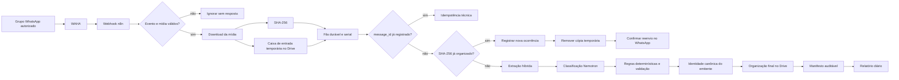

# Blueprint auditável — PLX · Triagem documental pelo WhatsApp V3.5

**Versão do blueprint:** 1.0
**Data:** 04/10/2026
**Ambiente validado:** Docker local
**Workflow canônico:** `plxUnifiedV35Draft`
**Objetivo:** receber documentos em um grupo autorizado do WhatsApp, preservar o original, identificar seu conteúdo, organizar no Google Drive, registrar rastreabilidade e informar exceções sem exigir leitura manual de todos os arquivos.

## 1. Resultado operacional esperado

Para cada documento recebido:

1. confirmar que a mensagem veio do grupo autorizado;
2. aceitar PDF, XML, JPG ou PNG;
3. preservar a data e a identidade da mensagem do WhatsApp;
4. calcular SHA-256 do conteúdo;
5. impedir processamento e armazenamento repetidos de arquivo idêntico;
6. extrair e classificar o documento;
7. identificar empresa, setor, tipo e data de referência;
8. organizar no Drive;
9. registrar tudo no manifesto;
10. sinalizar dados ausentes ou baixa confiança;
11. produzir fechamento diário por categorias e pendências.

O sistema prepara documentos para lançamento no sistema contábil. Ele não substitui o sistema contábil, não paga boletos e não toma decisões fiscais.

## 2. Arquitetura



### Responsabilidades

| Componente | Responsabilidade |
|---|---|
| WAHA | receber eventos e disponibilizar mídia do WhatsApp |
| n8n | validar, orquestrar, decidir rotas e integrar serviços |
| Fila local | absorver rajadas, serializar documentos, aplicar retries e evitar concorrência destrutiva |
| Extração híbrida | extrair texto e sinais de PDF, XML e imagens |
| NVIDIA Nemotron | classificar conteúdo e devolver contrato estruturado |
| Regras determinísticas | validar CNPJ, chave fiscal, datas e coerência entre tipo e setor |
| Google Drive | armazenar original temporário, arquivo organizado e relatórios |
| Data Table do n8n | manter manifesto de recebimentos, decisões, estado e caminho final |

## 3. Contrato de entrada

```json
{
  "source_file_id": "id do original temporário no Drive",
  "source_filename": "nome recebido",
  "mime_type": "application/pdf",
  "group_id": "{{WHATSAPP_GROUP_ID}}@g.us",
  "message_id": "id único da mensagem WhatsApp",
  "sender_id": "participante do grupo",
  "sha256": "hash do conteúdo",
  "received_at": "data e hora reais do recebimento",
  "idempotency_key": "waha:<group_id>:<message_id>",
  "company_name": "empresa atendida",
  "company_cnpj": "CNPJ da empresa atendida"
}
```

`message_id` identifica a ocorrência. `sha256` identifica o conteúdo físico. Eles não são intercambiáveis.

## 4. Regra de duplicidade

### Caso A — mesmo `message_id`

É repetição técnica do mesmo evento. A fila devolve o mesmo job e não cria nova ocorrência.

### Caso B — outro `message_id`, mesmo SHA-256

É um reenvio real de um documento já conhecido.

- registrar nova linha com `status = DUPLICATE_CONTENT`;
- preservar o novo `message_id`, remetente e `received_at`;
- reutilizar `drive_file_id` e `drive_path` do original organizado;
- remover a cópia temporária recém-criada;
- não executar OCR, IA, classificação nem nova organização;
- não contar novamente no total de documentos organizados;
- confirmar no grupo que o arquivo já estava salvo, com data anterior e localização.

Essa separação permite responder simultaneamente a duas perguntas:

- Quantas vezes o cliente enviou documentos?
- Quantos documentos únicos foram organizados?

## 5. Classificação e roteamento

| Documento | Departamento esperado |
|---|---|
| NF-e, NFC-e, NFS-e, CT-e, MDF-e e cupom fiscal | Fiscal |
| Boleto, extrato e comprovante de pagamento | Contábil |
| Atestado, admissão, folha, holerite, FGTS e INSS | Pessoal |
| Tipo desconhecido ou evidência insuficiente | Revisar |

O modelo sugere. Regras determinísticas conferem sinais críticos. Um documento reconhecido pode ser arquivado mesmo com dado secundário ausente, usando `ORGANIZED_ATTENTION` e uma observação específica.

### Falha fechada

Não deve haver “sucesso” quando ocorrer:

- mídia indisponível;
- saída inválida do modelo;
- falha no Drive;
- ausência do arquivo final;
- falha definitiva após retries;
- tipo ou identidade sem evidência mínima para roteamento seguro.

## 6. Estrutura canônica do Drive

```text
PLX - Documentos/
└── Razão social do emitente/
    └── Ano de referência/
        └── Departamento/
            └── Mês/
                └── Dia/
                    └── arquivo-renomeado.ext
```

O manifesto preserva nome original, nome organizado, data recebida, data do documento, remetente, classificação, observações e link do Drive.

## 7. Estados do documento

| Estado | Significado |
|---|---|
| `RECEIVED` | evento aceito e original preservado |
| `QUEUED` | aguardando processamento serial |
| `PROCESSING` | extração, classificação ou organização em curso |
| `ORGANIZED` | organizado com evidência suficiente |
| `ORGANIZED_ATTENTION` | organizado, mas exige conferência de campo específico |
| `DUPLICATE_CONTENT` | nova ocorrência de conteúdo já organizado; nenhuma nova cópia final |
| `FAILED` | falha técnica após esgotar tentativas |

## 8. Manifesto mínimo

Campos essenciais:

- `idempotency_key`;
- `message_id`;
- `sha256`;
- `group_id` e `sender_id`;
- `received_at` e `organized_at`;
- `original_filename` e `mime_type`;
- `document_type` e `department`;
- `issuer_cnpj` e identidade canônica;
- `reference_date` e `document_number`;
- `status`, `confidence`, `review_required` e `review_reason`;
- `drive_file_id` e `drive_path`;
- `attempt_count` e `last_error`;
- tempos de extração, classificação, Drive e total.

## 9. Relatório diário

O fechamento das 18h deve considerar apenas `ORGANIZED` e `ORGANIZED_ATTENTION` efetivamente concluídos naquele dia operacional.

Deve informar:

- quantidade de documentos únicos organizados;
- distribuição por categoria;
- distribuição por departamento;
- quantidade que exige atenção;
- observações objetivas por arquivo.

Não soma valores financeiros e não conta `DUPLICATE_CONTENT` como novo documento.

## 10. Segurança e governança

- allowlist explícita de grupos;
- recusa de conversas privadas, mensagens próprias e eventos sem mídia;
- allowlist de MIME;
- validação estrita da URL interna de mídia do WAHA;
- credenciais mantidas no cofre do n8n;
- webhook interno da fila protegido por token;
- original e manifesto separados da resposta da IA;
- modelo nunca decide pagamento ou obrigação fiscal;
- logs não devem registrar documento integral nem credenciais;
- rollback por exportação do workflow e persistência da fila.

## 11. Resiliência

- fila SQLite durável em volume Docker;
- uma única execução de documento por vez;
- deduplicação atômica da entrada da fila;
- até cinco tentativas para falha técnica recuperável;
- status `FAILED` após esgotamento;
- reinício do n8n não elimina fila nem arquivos já recebidos;
- recuperação deve reconciliar WAHA, manifesto e Drive.

## 12. Situação do ambiente em 04/10/2026

### Ativo

- workflow unificado publicado;
- 80 nós;
- entrada WAHA protegida;
- fila durável saudável;
- deduplicação por `message_id` e por SHA-256;
- confirmação de reenvio idêntico habilitada;
- workflow de erro ativo.

### Ainda em piloto silencioso

- confirmação comum de documento novo desabilitada;
- envio automático do fechamento diário desabilitado;
- operação local antes da migração ao VPS.

## 13. Evidências e testes

- dois envios reais do mesmo PDF foram encontrados em 30/09/2026 e 02/10/2026;
- IDs de mensagem diferentes;
- SHA-256 e tamanho idênticos;
- teste de regressão garante datas de recebimento distintas;
- lote real de 51 arquivos processado sem perda;
- rajada de cinco documentos distintos validada;
- vinte entradas concorrentes idênticas resultaram em um job aceito;
- XML e falha com retries possuem gates próprios;
- conjunto consolidado executado após a correção.

## 14. Perguntas para auditoria por outra IA

Peça que a IA responda com achados classificados em `CRÍTICO`, `ALTO`, `MÉDIO` e `BAIXO`:

1. Há alguma rota capaz de gerar falso sucesso?
2. A separação entre ocorrência (`message_id`) e conteúdo (`sha256`) está correta?
3. Existe condição de corrida entre consulta do SHA-256 e gravação do manifesto?
4. A remoção da cópia temporária pode apagar o arquivo canônico por engano?
5. A fila garante recuperação após reinício e indisponibilidade do n8n?
6. O manifesto permite reconciliar WAHA, Drive e relatório?
7. Os critérios de baixa confiança são adequados para contabilidade?
8. O fechamento diário exclui corretamente reenvios e falhas?
9. Quais dados pessoais ou empresariais exigem política LGPD adicional?
10. O desenho pode ser transformado em template multiempresa sem misturar dados?
11. O que precisa mudar antes do VPS e do primeiro cliente real?
12. Quais testes end-to-end ainda faltam com documentos reais?

## 15. Critério de conclusão comercial

O produto estará pronto para piloto assistido quando:

- um documento novo percorrer WhatsApp → WAHA → fila → IA → Drive → manifesto;
- o mesmo arquivo reenviado confirmar sem nova cópia nem nova IA;
- um arquivo ilegível gerar atenção clara;
- uma rajada não perder documentos;
- parada e retomada recuperarem o backlog;
- relatório reconciliar com manifesto e Drive;
- a contabilidade aceitar organização, linguagem e observações.
